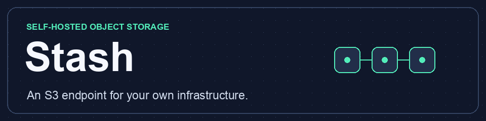
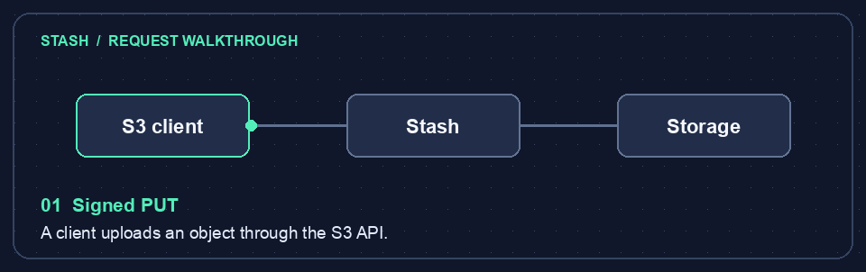

# Stash — Self-hosted S3 Object Storage



Stash is an open-source, self-hosted S3 object storage server and MinIO alternative for VPS, NAS, and small private deployments. It ships as a single Go binary that can run as a standalone server, a cluster coordinator, or a dedicated shard node.

Stash supports a [documented S3 subset](#s3-subset), including multipart uploads, presigned URLs, object versioning, and Object Lock. It also includes erasure coding, cross-site replication with manual failover, and a built-in [admin console](#admin-console-and-analytics). Stash is free to use, modify, and distribute under the [MIT License](LICENSE).

[See the head-to-head MinIO performance results](#stash-vs-minio-performance).

[Download v0.1.0](https://github.com/umeshracha/stash/releases/tag/v0.1.0) · [Umesh’s website](https://umeshracha.com) · [Quick start](#run-locally) · [S3 compatibility](#s3-subset) · [Admin console](#admin-console-and-analytics) · [MinIO benchmarks](#stash-vs-minio-performance) · [Current limitations](#current-limitations)

## Explore the features

<details open>
<summary><strong>Follow an object through Stash</strong></summary>



A signed S3 request uploads an object to a bucket. If you enable versioning, later writes preserve earlier versions. Authorized clients can retrieve an object through S3 or download it from the admin console.

</details>

<details>
<summary><strong>Upload, share, and protect objects</strong></summary>

- Use [multipart uploads](#multipart-checksums) to send large objects in parts. See the [verified client workflows](#verified-client-workflows) for tested operations.
- Create [presigned URLs](#presigned-urls-and-copy) to grant temporary access without handing out application credentials.
- Use [Object Lock](#object-lock) for retention and [encryption at rest](#encryption-at-rest) to protect stored data.

</details>

<details>
<summary><strong>Recover from storage or site failures</strong></summary>

[Erasure coding](#erasure-coding-and-healing) distributes data across shards and supports repair. [Cross-site replication](#replication-and-failover) copies versions and delete markers to another Stash instance. Failover is manual.

</details>

<details>
<summary><strong>See usage and investigate traffic</strong></summary>

The [admin console](#admin-console-and-analytics) shows storage usage, replica status, request counts, errors, and estimated p95 latency. Filter traffic by bucket, application, operation, or time range and export it as CSV.

</details>

## Current limitations

| Area | What to expect |
| --- | --- |
| S3 compatibility | The [supported S3 API subset](#s3-subset) uses path-style addressing. Check the [tested client workflows](#verified-client-workflows) for operations your application needs. |
| Site recovery | [Cross-site replication](#replication-and-failover) is asynchronous. Promotion requires an operator, and writes newer than the last replicated checkpoint can be lost during failover. |
| Admin and scale | The [web console](#admin-console-and-analytics) is read-only. Standalone bucket listings scan object metadata, which makes that layout best suited to smaller inventories. |
| Installation | Prebuilt Linux and macOS archives are available. Release builds are currently packaged manually. |

## Run locally

Requires Go 1.25 or later. Build on macOS or Linux.

```sh
go build -o stash ./cmd/stash
umask 077
cp stash.example.json stash.json
# Edit stash.json to replace the sample secrets with unique random secrets.
# Stash refuses to start while a secret still begins with "replace-this".
./stash -config stash.json
```

Stash binds to loopback by default. For remote use, configure both `tls_cert` and `tls_key`, or terminate TLS at a reverse proxy that preserves the signed request host, path, and query. Keep the configuration readable only by the service account. To rotate a credential, add a new access key and secret, restart, migrate the client, then remove the old credential and restart again.

Stash stops cleanly on SIGINT or SIGTERM: it stops accepting connections, gives requests in progress up to 30 seconds to finish, writes its final traffic statistics, releases the data directory, and exits with status 0. Set `TimeoutStopSec` above 30 seconds in a systemd unit.

Each credential maps bucket names to grants. A named grant takes precedence over `*`. The `read` grant allows listing and reading, `write` adds object writes and deletes, and `admin` adds bucket creation and deletion.

## Project layout

| Path | Responsibility |
| --- | --- |
| `cmd/stash/` | Primary executable entry point. The root entry point also supports existing `go build .` callers. |
| `internal/cli/` | Command-line flags shared by both entry points. |
| `internal/server/` | S3 handlers, object metadata, lifecycle and replication orchestration, and coordinator state. |
| `internal/server/web/` | Embedded admin console template. |
| `internal/erasure/` | Erasure coding, shard storage and transport, quorum checks, and healing. |
| `internal/encryption/` | Keyrings and authenticated encryption for object data. |
| `internal/upload/` | Multipart checksum negotiation and signed streaming payload verification. |
| `internal/sigv4/` | AWS Signature Version 4 request verification and canonicalization. |
| `internal/etcd/` | Quorum metadata transport, transactions, and TLS configuration. |
| `internal/audit/` | Request audit logs and log rotation. |
| `internal/fsutil/`, `internal/netutil/` | Atomic file writes and loopback address checks. |
| `tools/` | Repeatable performance benchmarks. |

Run the Go tests with `go test ./...`.

## Try the API

Use the credentials from your configuration. Configure path-style addressing and use the configured region.

```sh
aws configure set s3.addressing_style path --profile stash
export AWS_PROFILE=stash
export AWS_ACCESS_KEY_ID=stash-admin
export AWS_SECRET_ACCESS_KEY='<configured secret>'
export AWS_DEFAULT_REGION=us-east-1

aws --endpoint-url http://127.0.0.1:9000 s3api create-bucket --bucket reports
aws --endpoint-url http://127.0.0.1:9000 s3api put-object --bucket reports --key example.txt --body example.txt
aws --endpoint-url http://127.0.0.1:9000 s3api list-objects-v2 --bucket reports
aws --endpoint-url http://127.0.0.1:9000 s3api get-object --bucket reports --key example.txt downloaded.txt
```

When a request is refused, the S3 error says why:

| Error | Meaning |
| --- | --- |
| `InvalidAccessKeyId` | The access key ID is not in the configuration. |
| `SignatureDoesNotMatch` | The secret, the signed headers, or the path and query differ from what the server computed. Behind a proxy, check that it preserves the `Host` header. |
| `RequestTimeTooSkewed` | The client clock is more than 15 minutes from the server's. |
| `AuthorizationHeaderMalformed` | The request is not valid SigV4, or it was signed for another region. The message names the expected region. |
| `AccessDenied` | The request was anonymous, a presigned URL expired, a header was not signed, or the credential has no grant for the operation. |

## S3 subset

- Bucket APIs include CreateBucket, ListBuckets, HeadBucket, GetBucketLocation, and DeleteBucket for empty buckets. Bucket names use 3–63 lowercase ASCII letters, digits, or hyphens, starting and ending with a letter or digit.
- Object APIs include PutObject, GetObject, HeadObject, DeleteObject, DeleteObjects, and ListObjectsV2. Listing supports prefixes, delimiters, pagination, and URL-encoded keys.
- Single-request uploads support up to 5 GiB, user metadata, and checksums sent in headers. Downloads support byte ranges and ETags.
- Requests use header-based SigV4 and path-style addressing. Stash verifies chained signatures on signed streaming uploads. PutObject and UploadPart accept AWS chunked payloads with signed or unsigned checksum trailers.
- Verified with AWS CLI 2.36.8 using the default checksum settings and path-style addressing. The smoke test covered checksummed uploads, Unicode keys, paginated listing, range downloads, bucket isolation, restart persistence, and batch deletion.
- Multipart APIs include CreateMultipartUpload, UploadPart, ListParts, CompleteMultipartUpload, and AbortMultipartUpload. Parts persist across restarts. A successful completion publishes the whole object atomically and preserves metadata supplied at initiation. Abort incomplete uploads by their upload ID. Completion temporarily needs space for both the staged parts and the assembled object.
- Multipart uploads support up to 10,000 parts, 5 GiB per part, and 5 TiB per object. Every part except the final one must be at least 5 MiB.
- Stash validates signed payload hashes, multipart checksum negotiation, and per-part checksums sent in headers or trailers.

### Verified client workflows

| Client | Configuration | Verified transfers |
| --- | --- | --- |
| AWS CLI 2.36.8 | Path-style SigV4, default checksums over TLS | Single and multipart uploads, download with byte comparison |
| boto3 1.43.126 | Path-style, default checksums over TLS | Single and multipart managed uploads, download with byte comparison and checksum metadata |
| Go AWS SDK v2 S3 1.114.9 | Path-style over TLS, `aws.RequestChecksumCalculationWhenSupported` | Single upload with checksum, multipart upload and part listing, download with byte comparison |
| MinIO Client `RELEASE.2026-09-19T15-24-59Z` | Alias with `--api S3v4 --path on` | Three-part upload with `mc put --part-size 5MiB --checksum MD5`, download with byte comparison |

## Presigned URLs and copy

SigV4 query signing supports path-style object GET, HEAD, and PUT with an expiry from one second to seven days. Use an S3 SDK to sign the URL for the exact endpoint and method. The signer needs the same bucket permission as for a regular request. Anyone with the URL can perform its signed operation until it expires or the credential loses access.

Use `aws s3api copy-object` for server-side copies within the deployment. Copy requires read access to the source bucket and write access to the destination. The default preserves object metadata. Use `--metadata-directive REPLACE` to supply new metadata. A single copy supports objects up to 5 GiB. Append `?versionId=VERSION` to the copy source to copy a specific version. Copy supports source ETag and modification-time conditions. Use `UploadPartCopy` to copy a whole source or an explicit byte range into an active multipart upload. Source permissions and conditions apply to each copied part.

## Object versioning

Enable or suspend versioning through `PutBucketVersioning` using a bucket admin credential. Objects created before enabling versioning remain readable with version ID `null`. New uploads, copies, and multipart completions get distinct version IDs in an enabled bucket. A delete without a version ID creates a delete marker. Delete that marker by ID to make the previous version current again. Suspending versioning preserves numbered versions and replaces the `null` version on subsequent writes or deletes.

Use `ListObjectVersions` to discover versions and markers, and use `versionId` to read or permanently delete a specific version. Delete all versions and markers before deleting a bucket. The current filesystem backend scans version metadata to resolve the latest version and build listings.

## Replication and failover

Stash can pull versions and delete markers from another Stash instance. Add a shared token of at least 24 characters to the source configuration and enable versioning on the source bucket.

```json
{
  "replication_exports": {
    "reports": "<shared random token>"
  }
}
```

On the destination, add a replica rule to the server configuration. The destination bucket must start empty. Use HTTPS for remote endpoints. Plain HTTP is available for loopback IP addresses.

```json
{
  "replica_buckets": {
    "reports": {
      "endpoint": "https://primary.example.com",
      "bucket": "reports",
      "token": "<shared random token>",
      "interval_seconds": 10
    }
  }
}
```

The replica serves reads and rejects application writes. It stages and verifies changed versions, then applies them and records a durable checkpoint. A standalone primary provides an incremental feed for up to 256 recent version changes. Once a replica has an inventory checkpoint, normal polls fetch only changes since its saved cursor. It retries after an outage and mirrors permanent version deletions as well as delete markers. A crash during publication requires a successful sync before promotion. The status endpoint at `/.stash/replication/reports/status` accepts a SigV4 request from a bucket administrator and reports the latest checkpoint and error.

For manual failover, fence the old primary so it cannot accept writes, remove the destination's replica rule, add `"promote_buckets": ["reports"]`, and restart. Promotion requires a completed checkpoint and persists across restarts. Redirect clients to the promoted server. Replication is asynchronous, so writes newer than the last checkpoint may be missing after failover.

Initial backfill, source restarts, and expired cursors use a streamed inventory. The source creates a temporary metadata snapshot and releases its storage lock before sending it. The replica verifies that the snapshot still matches before publishing staged changes. Coordinator clusters and replica-to-replica exports also use the streamed inventory. The destination needs scratch space for changed objects and memory for the incoming version metadata. Older sources use the legacy inventory endpoint, which has a 32 MiB response limit.

## Erasure coding and healing

To store new object bodies across drives, configure existing, dedicated drive directories and a parity count.

```json
{
  "erasure": {
    "drives": ["/mnt/drive1", "/mnt/drive2", "/mnt/drive3", "/mnt/drive4"],
    "parity": 2
  }
}
```

The drive order and parity count are fixed for a data directory. Use separate physical drives to tolerate drive failures. Each stripe has one shard per configured drive. A read needs as many intact shards as there are data shards. A write needs that many durable shards and a strict majority of the drives. Stash checks block hashes and reconstructs missing blocks for reads, including range requests. Existing objects retain their original format.

With the server stopped, run `./stash -config stash.json -heal` to scrub and repair shards and remove unreferenced shard files from this layout. For a replacement drive mounted at the original path, run `./stash -config stash.json -replace-erasure-drive 1` with the relevant one-based drive index. The command initializes the layout directory on the replacement and then heals. Keep the metadata directory on durable storage and back it up alongside the shard directories.

## Erasure coding across nodes

Run one dedicated Stash process on each shard node. Its configuration supplies `listen`, `data_dir`, and a `shard_node_token` of at least 24 bytes. Configure `tls_cert` and `tls_key` for non-loopback traffic. Each node stores one shard per object stripe. Use distinct hosts or failure domains for the nodes.

On the S3 coordinator, configure `erasure.nodes` in place of `erasure.drives`.

```json
{
  "erasure": {
    "parity": 2,
    "nodes": [
      {"endpoint": "https://shard1.example.com", "token": "<node 1 token>"},
      {"endpoint": "https://shard2.example.com", "token": "<node 2 token>"},
      {"endpoint": "https://shard3.example.com", "token": "<node 3 token>"},
      {"endpoint": "https://shard4.example.com", "token": "<node 4 token>"}
    ]
  }
}
```

For four nodes with two parity shards, two intact shards suffice for reads, and three durable shards are required for writes. The coordinator verifies checksums on range reads and reconstructs damaged or missing blocks. Keep shard nodes running while running `-heal` with the S3 coordinator stopped. Bring a replacement node online at the original endpoint before healing. Offline healing also reclaims unreferenced shards in the coordinator's layout namespace.

A standalone S3 coordinator keeps the authoritative object and bucket metadata in its data directory. Use cluster metadata mode for multiple coordinators. Each shard node should be dedicated to this layout and protected with its own token.

## Quorum-backed cluster metadata

Configure two or more Stash coordinators with the same ordered shard nodes, S3 credentials, region, cluster name, and etcd endpoints. Give each coordinator its own initially empty data directory. Run etcd as a separate quorum with three or more members. For remote endpoints, use HTTPS and secure etcd access. Stash accepts an optional etcd CA file and client certificate pair through `ca_file`, `client_cert`, and `client_key`, or an etcd authentication token through `token`.

```json
{
  "cluster": {
    "name": "stash-cluster",
    "endpoints": ["https://etcd1.example.com:2379", "https://etcd2.example.com:2379", "https://etcd3.example.com:2379"]
  }
}
```

A coordinator reads the current metadata from the etcd quorum before serving requests. Shards are committed before the corresponding metadata transaction. If a competing coordinator has already changed the same bucket revision, the request returns `503` and can be retried. If etcd loses quorum, object requests return `503`. Route traffic to another coordinator after a coordinator failure. Uploaded multipart parts, versions, and delete markers are shared between coordinators.

Metadata is partitioned by bucket, with a 768 KiB compressed snapshot limit per bucket. Coordinators read a quorum-backed revision and reload only partitions that changed. Each coordinator still serializes its own requests. If etcd roles restrict key access, allow the cluster root key and the bucket prefix `/stash/metadata/<cluster-name>/buckets/`. To upgrade a legacy shared-snapshot cluster, stop its coordinators and start one upgraded coordinator to migrate the metadata before starting the rest. The migration publishes its new root after all bucket partitions are staged. Use a separate coordinator configuration and data directory to run `-heal` against live shard nodes. Cluster healing verifies and repairs referenced shards without sweeping, since another coordinator could still be publishing a new shard set. Cross-site replica ingestion currently runs on standalone coordinators.

### Verified failure scenarios

| Fault | Observed behavior |
| --- | --- |
| One shard link disconnected in a four-node 2+2 layout | Readiness stayed healthy and a new write succeeded with three shards. |
| Two shard links disconnected | Existing data was readable with byte-range reconstruction. Readiness and writes returned `503`. |
| Three shard links disconnected | Reads returned `503`. |
| Corrupt and missing shards after reconnection | A read matched the source bytes. Healing repaired the corrupt and missing shards. |
| Coordinator disconnected from all etcd client endpoints | Reads, writes, and readiness returned `503`. Operations recovered when the links were restored. |
| All three etcd peer links disconnected with the members still running | The quorum disappeared. S3 reads and small writes returned `503`, and a larger upload was rejected with a closed connection. The rejected small write was absent after quorum recovered. |

The link tests interrupted existing TCP connections while the affected services kept running. Separate process-loss tests verified coordinator handoff, multipart completion after handoff, and metadata recovery after quorum returned.

## Admin console and analytics

Enable the read-only console with a separate username and password, then visit `/.stash/admin/`. Use TLS for remote access. Direct loopback access supports plain HTTP for local administration.

```json
{
  "admin": {"username": "operator", "password": "<unique password of at least 16 bytes>"}
}
```

The console shows current object counts, bytes held by all versions, local filesystem space, and replica status. Browse current objects by bucket and prefix, and download files as attachments. Filter traffic by bucket, application label, operation, and time range. Set an optional `label` on an S3 credential to distinguish its traffic. Stash records request and error counts, upload wire bytes, downloaded object bytes, and a histogram estimate for p95 latency. Object names, request bodies, and credentials are excluded from traffic metrics.

Hourly traffic aggregates and storage samples are retained locally for 30 days and checkpointed every 10 seconds when changed. Traffic and storage CSV exports follow the console filters relevant to each dataset. In cluster mode, traffic metrics are per coordinator. Storage samples use the coordinator's view of the cluster inventory. Local disk usage describes the coordinator filesystem.

## Access policies, audit, and health

A credential can refer to named identity policies using its `policies` array. Existing `read`, `write`, and `admin` grants still work. An explicit deny in an identity or bucket policy overrides a grant.

```json
{
  "policies": {
    "public-reader": {
      "Version": "2012-10-17",
      "Statement": [
        {"Effect": "Allow", "Action": "s3:GetObject", "Resource": "arn:aws:s3:::reports/public/*"},
        {"Effect": "Allow", "Action": "s3:ListBucket", "Resource": "arn:aws:s3:::reports",
         "Condition": {"StringLike": {"s3:prefix": "public/*"}}}
      ]
    }
  }
}
```

Actions and resources accept one string or a list. Patterns support `*` and `?`. The supported condition operators are `StringEquals` and `StringLike` for `s3:prefix` on bucket listings. Explicitly granting `s3:ListAllMyBuckets` on `*` exposes all bucket names. Otherwise, bucket discovery is scoped to buckets the caller can list without a prefix.

Bucket administrators can use the S3 get, put, and delete bucket policy operations. Bucket policy statements use `"Principal": {"AWS": "<local access key ID>"}` or a list of local access key IDs. Resources must belong to the target bucket. All access requires SigV4 authentication, including requests granted access by a bucket policy.

Set `"audit_log": true` to record S3 requests and their HTTP outcomes in `v1/.audit.jsonl` on each coordinator. Entries include the authenticated access key ID, bucket, operation, request ID, and duration. Logs omit object keys, payloads, secrets, and query strings. Stash syncs each entry and retains the current file and four rotated archives of up to 10 MiB each. Audit logging is best effort and logs write failures to the server log.

Use `/healthz` for process liveness and `/readyz` for readiness. In cluster mode readiness requires a successful metadata quorum read. Erasure mode also checks that enough shard locations are reachable for a write.

## Object Lock

Create a bucket with `--object-lock-enabled-for-bucket` to enable versioning and Object Lock together. A bucket administrator can also enable Object Lock on an existing versioned bucket. Once enabled, versioning cannot be suspended.

Use the S3 Object Lock configuration API to set a default retention period in days or years. New object versions inherit the default unless the upload specifies an explicit mode and retain-until date. Set or inspect version retention and legal holds through the S3 retention and legal hold APIs.

Compliance retention prevents permanent deletion, shortening the retention period, or switching modes while the retention is active. Governance retention can be bypassed only when the request explicitly asks for bypass and the caller has `s3:BypassGovernanceRetention`. A legal hold blocks permanent deletion even when governance bypass is authorized. A delete without a version ID can still create a delete marker. Replica checkpoints preserve lock settings and per-version protection through promotion.

## Lifecycle expiration

Use the S3 get, put, and delete lifecycle configuration APIs to manage bucket rules. Stash supports prefix filters, current object expiration by age or UTC date, expired delete marker cleanup, noncurrent version expiration, and aborting incomplete multipart uploads. Unsupported filters and actions are rejected when the rule is submitted.

The server sweeps on startup and hourly. Run `./stash -config stash.json -lifecycle-once` to apply rules once while the local coordinator is stopped. A versioned bucket expires a current object by creating a delete marker. Permanent expiration respects retention and legal holds, and the sweep never bypasses governance protection. Replica buckets apply local rules after promotion.

## Encryption at rest

Generate a private 32-byte key file and set its ID as the active key.

```sh
umask 077
openssl rand -base64 32 > stash-object-key
```

```json
{
  "encryption": {
    "active_key": "primary",
    "key_files": {"primary": "stash-object-key"}
  }
}
```

Stash encrypts new object bodies and multipart staging with chunked AES-256-GCM. It encrypts before erasure coding and verifies each chunk before returning its bytes, including range downloads. Existing plaintext objects remain readable in their original format. Bucket and object metadata remain visible on disk. With encryption enabled, S3 clients may request `AES256` explicitly.

A standalone server can rotate the active key by adding a new key ID and changing `active_key`. A replica can use its own keyring and encrypts received data with its own active key.

For a cluster, preload the new key file on each coordinator and restart coordinators with the expanded `key_files` map. The etcd root selects the active key after cluster creation. Use a separate coordinator data directory and a config containing all current keys with `active_key` set to the new key ID, then run:

```sh
./stash -config rotate.json -rotate-cluster-key
```

The command commits the new active key and its fingerprint through etcd. Prepared coordinators start using it on their next request. Coordinators missing any committed key fail readiness and return `503` until restarted with the full keyring. Writes staged against the previous root revision cannot commit after rotation. Keep the older key files for existing objects, multipart parts, and backups. Rotation changes the key used for new writes.

## Multipart checksums

Choose a checksum when initiating an upload. CRC32 and CRC32C support `FULL_OBJECT` and `COMPOSITE`, CRC64NVME supports `FULL_OBJECT`, and SHA1 and SHA256 support `COMPOSITE`. Stash computes and verifies checksums for uploaded and copied parts. A checksum supplied at completion must match the assembled object or its composite checksum. Composite uploads use consecutive part numbers starting at one.

Completion and checksum-enabled reads return the resulting checksum and its type. A single server-side copy recomputes a whole-object checksum when the source has a checksum or the copy specifies an algorithm.

## Stash vs MinIO performance

Five alternating trials per server on an Apple M1 Pro (10 CPU cores, 32 GiB RAM), macOS 26.4.1, APFS, and loopback HTTP. Both servers used a fresh directory on the same filesystem, Go 1.26.5, and the same boto3 1.43.126 client with default checksum settings. The Stash build used commit `141c383`. MinIO Community was built from [RELEASE.2025-10-15T17-29-55Z](https://github.com/minio/minio/releases/tag/RELEASE.2025-10-15T17-29-55Z) at commit `9e49d5e7a648`.

The client warmed up each server with eight 256 KiB objects. It then uploaded and downloaded 256 objects of 4 KiB with eight workers and 64 objects of 2 MiB with four workers. Downloads followed writes with a warm filesystem cache. The client compared every download byte for byte. Each cell reports the median of the five trial values.

| Workload | Stash throughput | MinIO throughput | Stash p95 | MinIO p95 |
| --- | ---: | ---: | ---: | ---: |
| 4 KiB PUT | 157.0 req/s | 680.1 req/s | 70.33 ms | 17.13 ms |
| 4 KiB GET | 1,046.0 req/s | 1,078.7 req/s | 12.34 ms | 12.85 ms |
| 2 MiB PUT | 166.76 MiB/s | 554.95 MiB/s | 55.13 ms | 18.21 ms |
| 2 MiB GET | 1,497.65 MiB/s | 1,386.51 MiB/s | 6.74 ms | 8.20 ms |
| Peak server RSS | 21.67 MiB | 391.72 MiB | | |

MinIO delivered 4.33× the small-object upload rate and 3.33× the large-object upload throughput. Stash delivered 8% higher warm 2 MiB GET throughput and used 94% less peak server memory in these trials. These results cover single-node, single-directory transfers. Networked clusters, cold reads, and sustained mixed traffic are separate workloads.

[Raw results for all ten trials](docs/benchmarks/stash-vs-minio.json)

To reproduce one trial per server, run these commands with Python 3 and boto3 installed. Repeat with alternating server order for the five-trial comparison.

```sh
go build -o stash ./cmd/stash
minio_bin_dir=$(mktemp -d)
GOBIN="$minio_bin_dir" go install github.com/minio/minio@RELEASE.2025-10-15T17-29-55Z
python3 tools/bench.py ./stash --layout standalone
python3 tools/bench.py "$minio_bin_dir/minio" --layout minio
```

### Small PUT optimization on macOS

A follow-up on the same APFS host used three trials per build, rotating the order of the original Stash build, the optimized build, and MinIO. Each trial used eight workers to upload 256 objects of 4 KiB. The table reports the median across trials.

| Build | Throughput | p95 |
| --- | ---: | ---: |
| Stash before batching | 150.9 req/s | 74.02 ms |
| Stash with batching | 274.0 req/s | 38.09 ms |
| MinIO Community | 650.0 req/s | 18.52 ms |

Stash batches overlapping commits for objects up to 64 KiB staged in the destination directory on local APFS. It syncs each file and flushes the drive cache before renaming the files, then syncs the directory before returning success. Other paths use the individual file and directory sync sequence. The benchmark measures process-level upload behavior on one host. [Apple's explanation of drive cache flushing](https://developer.apple.com/videos/play/wwdc2019/419/)

## Performance baseline

The benchmark starts a fresh Stash deployment, warms it up with eight 256 KiB objects, then measures concurrent S3 PUTs followed by GETs of the same objects. The client verifies every download byte for byte. The small workload uses 256 objects of 4 KiB with eight workers. The large workload uses 64 objects of 2 MiB with four workers. Each table cell is the median of that metric over three fresh runs.

The reference system was an Apple M1 Pro (10 CPU cores, 32 GiB RAM), macOS 26.4.1, Go 1.26.5, and boto3 1.43.126. The client and server shared the host and used loopback HTTP and SigV4 with boto3's default checksum settings. The cluster run used one coordinator, four HTTP shard processes, and three etcd 3.6.16 members on that host. All shard directories shared the host filesystem. Reads immediately followed writes with the filesystem cache left warm. These runs measure the network protocol and quorum costs on loopback. Dedicated hosts, independent drives, and cold reads have different costs.

| Layout | Object | Method | Requests/s | MiB/s | p50 ms | p95 ms | p99 ms |
| --- | --- | --- | ---: | ---: | ---: | ---: | ---: |
| Standalone | 4 KiB | PUT | 149.8 | 0.59 | 52.25 | 71.72 | 77.73 |
| Standalone | 4 KiB | GET | 1133.9 | 4.43 | 6.27 | 12.72 | 15.68 |
| Standalone | 2048 KiB | PUT | 47.4 | 94.71 | 48.22 | 126.94 | 154.97 |
| Standalone | 2048 KiB | GET | 720.2 | 1440.42 | 5.30 | 7.35 | 9.36 |
| Local 2+2 erasure | 4 KiB | PUT | 33.3 | 0.13 | 236.02 | 307.58 | 334.90 |
| Local 2+2 erasure | 4 KiB | GET | 1057.7 | 4.13 | 6.95 | 13.13 | 15.96 |
| Local 2+2 erasure | 2048 KiB | PUT | 18.0 | 35.92 | 185.83 | 376.04 | 416.25 |
| Local 2+2 erasure | 2048 KiB | GET | 618.6 | 1237.24 | 5.98 | 8.46 | 11.07 |
| Networked 2+2 cluster | 4 KiB | PUT | 11.2 | 0.04 | 712.10 | 777.07 | 815.52 |
| Networked 2+2 cluster | 4 KiB | GET | 384.3 | 1.50 | 19.83 | 26.69 | 36.70 |
| Networked 2+2 cluster | 2048 KiB | PUT | 7.1 | 14.26 | 461.92 | 1055.58 | 1246.78 |
| Networked 2+2 cluster | 2048 KiB | GET | 155.5 | 310.91 | 23.65 | 39.69 | 44.07 |

| Layout | Total server CPU seconds per run | Highest process peak RSS MiB |
| --- | ---: | ---: |
| Standalone | 1.27 | 21.73 |
| Local 2+2 erasure | 4.81 | 31.27 |
| Networked 2+2 cluster | 14.20 | 82.84 |

On the same host, the Go version-head benchmark opened the current version of a key with 1,000 versions in 51.7 µs with a warm head cache and 32.6 ms when rebuilding the head. Both cases used the operating system's filesystem cache. The benchmark measures metadata lookup inside Stash and can be run with `go test ./internal/server -run '^$' -bench BenchmarkVersionHead -benchmem`.

Run with Python 3 and boto3 installed from the Stash source directory. Each invocation emits JSON for one run and removes its temporary data when finished.

```sh
go build -o stash ./cmd/stash
python3 tools/bench.py ./stash --layout standalone
python3 tools/bench.py ./stash --layout erasure
python3 tools/bench.py ./stash --layout cluster --etcd "$(command -v etcd)"
```

## Implemented and verified capabilities

1. **S3 data plane.** Multipart copy, full-object and composite checksums, and streaming checksum trailers are implemented. The compatibility matrix records the tested transfers for AWS CLI, boto3, Go AWS SDK, and MinIO Client.
2. **Versioned storage.** Bucket versioning, version IDs, and delete markers are implemented. Current-version lookups and version publication reuse a bounded version-head cache. A process-kill test verified recovery of the previous version after an interrupted overwrite.
3. **Replication and failover.** Incremental catch-up, streamed full backfill, and manual failover are implemented. A live replica backfilled and checkpointed 550 versions from a 33,897,974-byte inventory.
4. **Distributed durability.** Multi-drive and multi-node shard placement, quorum enforcement, and offline healing are implemented. Quorum-backed coordinator metadata is partitioned by bucket in etcd. Drive and node loss, corrupt shards, coordinator handoff, and shard and etcd link partitions were exercised against the documented quorum guarantees.
5. **Administration and performance.** The read-only console, object browser, and traffic and storage analytics are implemented. Policy-based access, S3 audit logging, and readiness checks are implemented. Object Lock, retention, and legal holds are implemented. Lifecycle expiration and object-body encryption at rest are implemented. Coordinated cluster key rotation is implemented. Throughput, latency, and resource use are published for standalone, local erasure, and networked cluster layouts.

Track coverage against the public [MinIO documentation](https://docs.min.io/aistor/). Compatibility claims apply to the API operations and workflows in the tested matrix.

## Data and backups

Run a single Stash process per data directory on a local filesystem. Stash writes uploads to temporary files and publishes complete objects using atomic rename after checksum verification. Object metadata and bytes share one file. The `v1` subdirectory identifies the format version. Bucket listings scan local object metadata and are intended for small deployments.

Stop the server before backing up or restoring. Back up the entire data directory and protect a separate copy of the configuration and TLS files. Restore the directory and configuration before restarting.

## Linux builds

```sh
CGO_ENABLED=0 GOOS=linux GOARCH=amd64 go build -o stash-linux-amd64 ./cmd/stash
CGO_ENABLED=0 GOOS=linux GOARCH=arm64 go build -o stash-linux-arm64 ./cmd/stash
```

## License

[MIT License](LICENSE) · Copyright © 2026 [Umesh](https://umeshracha.com)
